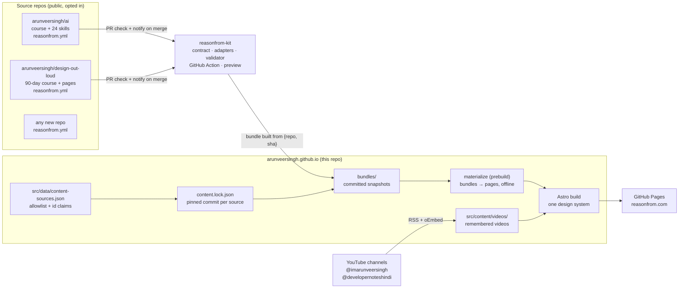
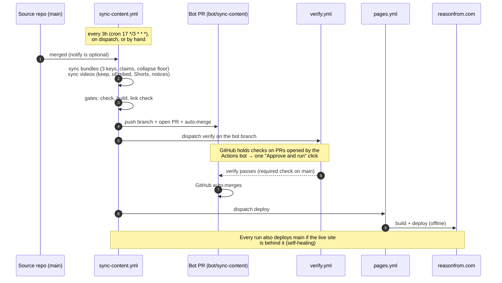

# reasonfrom.com: how the whole system works

This one page explains the architecture, the automation, everyday tasks, and how to set everything up from scratch on a new machine.

Last verified: 2026-11-05.

---

## 1. The idea

Content lives in many repos. reasonfrom.com is the only place readers see it.

The site never parses a repo's folder layout. Each **source repo** opts in, and **[reasonfrom-kit](https://github.com/arunveersingh/reasonfrom-kit)** turns it into a **bundle**: a validated, deterministic snapshot that follows one contract ([SPEC.md](https://github.com/arunveersingh/reasonfrom-kit/blob/main/SPEC.md)). The site renders bundles with a single design. YouTube videos come in through a separate, memory-keeping sync.

**Who owns what:**

| | Owns |
|---|---|
| Source repos | The content: lessons, pages, skills |
| The kit | The contract and the conversion from a repo's layout to a bundle |
| The site | Presentation (templates, wording, layout) and state (when an item first appeared, notices) |

---

## 2. Architecture



### Three keys to publish

A repo appears on the site only when **all three** of these are true. Private repos can't leak by mistake.

1. **Key 1:** it's listed in `src/data/content-sources.json`, with the id prefixes it may publish (`claims`).
2. **Key 2:** its own `reasonfrom.yml` says `publish: true`.
3. **Key 3:** it's public. This is proven with an anonymous `git ls-remote`, with credentials disabled.

### Rules worth knowing

- **Deploys are offline and reproducible.** `pages.yml` never touches the network. Content is committed, either in `bundles/` or `src/content/videos/`.
- **Bundles are deterministic.** The same commit always produces the same bytes. Rolling back a course means reverting one line in `content.lock.json`.
- **Videos are remembered.** A video is removed only when YouTube confirms it's deleted or private, never just because it scrolled out of the 15-item RSS feed. Its URL never changes when you retitle it.
- **Prose can't depend on repo layout.** Inside a bundle, links are `rf:<id>`, `rf-asset:<path>`, or absolute URLs. A broken relative link fails the source repo's PR.

---

## 3. Automation



| Workflow | Runs | Does |
|---|---|---|
| `verify.yml` | Every PR and every non-main push | Script tests, type-check, build, link check, sanity checks. **Required on main.** |
| `pages.yml` | Push to main, or dispatch | Offline build and deploy to Pages |
| `sync-content.yml` | Every 3h, dispatch from a source repo, or by hand | Syncs content, runs the gates, opens a bot PR, deploys, opens or closes one "Publish failing" issue |
| Source repo `reasonfrom.yml` workflow | PRs and pushes in `ai` and `design-out-loud` | Validates the bundle (`reasonfrom-kit@v0.5.0`). Notifies the site on merge if `REASONFROM_DISPATCH_TOKEN` is set |

---

## 4. Everyday tasks

| I want to… | Do this |
|---|---|
| **Publish a lesson** | Write it in the source repo, open a PR (its check validates the bundle), merge. It goes live within about 3h. Each bot PR needs one approval click (see §6). |
| **Schedule a lesson** | The contract supports `publish_at` on lessons, and the site hides a lesson until that day, but neither current adapter reads a date from your files yet. Ask to add it. |
| **Publish a video** | Upload to YouTube. Nothing else is needed: the next sync adds it, detects whether it's a Short, links it to related skills and courses, and gives long videos a 21-day "New video" notice. |
| **Link videos to skills or courses** | Edit `src/data/topic-links.ts` (keyword rule → skills and courses). |
| **Change a course's wording on the site** | Edit `src/data/course-presentation.ts`. |
| **Add a new course repo** | (1) Add `reasonfrom.yml` and the [example workflow](https://github.com/arunveersingh/reasonfrom-kit/blob/main/examples/source-workflow.yml) to the repo. (2) Make the repo public. (3) Add it to `src/data/content-sources.json` with its `claims`. (4) If its content is already public elsewhere, run `npm run sync:bundles -- --update --source owner/name --adopt` so it doesn't flood the site with "New" notices. |
| **Preview a private draft in the real design** | `npm run preview:source -- /path/to/repo` (local only, nothing is published) |
| **Roll back a course** | Revert its line in `content.lock.json` and its `bundles/<owner>/<repo>/` folder, then merge through a PR. |
| **Force a sync now** | `gh workflow run sync-content.yml --repo arunveersingh/arunveersingh.github.io` |

---

## 5. Fresh machine setup

### 5.1 Prerequisites

```bash
# macOS (Homebrew). Any OS works if these versions are met.
brew install git gh node python@3
node --version     # needs >= 22.12.0
gh --version
```

### 5.2 Sign in and set the commit identity

```bash
gh auth login                      # GitHub.com → HTTPS → browser
gh auth status

# Personal repos use this identity. No work email, no AI co-author lines.
git config --global user.name  "arunveersingh"
git config --global user.email "arunveersingh9@gmail.com"
```

### 5.3 Clone everything into one workspace

```bash
mkdir -p ~/reasonfrom && cd ~/reasonfrom
gh repo clone arunveersingh/arunveersingh.github.io site
gh repo clone arunveersingh/reasonfrom-kit
gh repo clone arunveersingh/ai
gh repo clone arunveersingh/design-out-loud
```

### 5.4 Run the site locally

```bash
cd ~/reasonfrom/site
npm ci                              # installs reasonfrom-kit pinned to a tag
npm run dev                         # materializes bundles, then serves http://localhost:4321
#   stop the server: npx astro dev stop
```

### 5.5 Run every gate, exactly as CI does

```bash
cd ~/reasonfrom/site
npm run test:scripts                # publishing and video rules (13 tests)
npm run check                       # astro check (materializes first)
npm run build                       # offline build to dist/
node scripts/check-links.mjs        # every internal link resolves
```

### 5.6 The kit

```bash
cd ~/reasonfrom/reasonfrom-kit
npm ci && npm test                  # contract + adapter tests

# Validate any source repo, the same check its PR runs
node bin/reasonfrom.mjs check ../ai --repo arunveersingh/ai
node bin/reasonfrom.mjs check ../design-out-loud --repo arunveersingh/design-out-loud

# Build a bundle to inspect it
node bin/reasonfrom.mjs bundle ../ai --repo arunveersingh/ai --out /tmp/ai-bundle
```

### 5.7 Skills repo checks

```bash
cd ~/reasonfrom/ai
python3 tools/lint_skills.py --strict                       # design contract
python3 tools/run_evals.py export | head                    # eval cases as JSONL
# Live model evals (costs money; use a different model family as judge):
# python3 tools/run_evals.py run --agent-cmd "claude -p" --judge-cmd "<other model cli>" --trials 3
```

### 5.8 Sync by hand (optional; the bot does this)

```bash
cd ~/reasonfrom/site
npm run sync:bundles -- --update     # move pins to each source's main, rebuild bundles
node scripts/sync-videos.mjs         # new uploads, Shorts, notices; never drops a video
npm run test:scripts && npm run check && npm run build && node scripts/check-links.mjs
# Commit on a branch and open a PR. main is protected and requires verify.
```

### 5.9 Preview a local repo (private drafts too)

```bash
cd ~/reasonfrom/site
npm run preview:source -- ~/path/to/draft-repo   # needs a reasonfrom.yml in that repo
# or, from the kit:
node ~/reasonfrom/reasonfrom-kit/bin/reasonfrom.mjs preview ~/path/to/draft-repo --site ~/reasonfrom/site
```

---

## 6. GitHub settings the system depends on

These live on GitHub, not in code. Check them on a new account, or after something breaks.

| Setting | Expected | Check with |
|---|---|---|
| Branch protection on `main` (site) | required check `verify`, strict | `gh api repos/arunveersingh/arunveersingh.github.io/branches/main/protection --jq .required_status_checks` |
| Auto-merge (site) | on | `gh api repos/arunveersingh/arunveersingh.github.io --jq .allow_auto_merge` |
| Actions may open PRs (site) | `can_approve_pull_request_reviews: true`, default permissions `read` | `gh api repos/arunveersingh/arunveersingh.github.io/actions/permissions/workflow` |
| Pages (site) | GitHub Actions source, custom domain `reasonfrom.com` | `gh api repos/arunveersingh/arunveersingh.github.io/pages --jq '{cname,build_type}'` |
| `REASONFROM_BOT_TOKEN` (site, optional) | **Currently empty**, so bot PRs need one approval click | Settings → Secrets → Actions |
| `REASONFROM_DISPATCH_TOKEN` (`ai`, `design-out-loud`, optional) | Not set, so the 3-hourly cron picks up merges instead | Settings → Secrets → Actions |

**About the approval click.** GitHub holds checks on PRs opened by its own Actions bot until a person approves them. To publish a bot PR, open it, go to the held `verify` run, and click **Approve and run**. To remove that click, create a fine-grained token (this repo only; Contents and Pull requests read and write) and save it **in the browser** as `REASONFROM_BOT_TOKEN`. Never paste it into a terminal command or a chat.

To set up the Actions permission from scratch:

```bash
gh repo edit arunveersingh/arunveersingh.github.io --enable-auto-merge
gh api -X PUT repos/arunveersingh/arunveersingh.github.io/actions/permissions/workflow \
  -f default_workflow_permissions=read -F can_approve_pull_request_reviews=true
```

---

## 7. Troubleshooting

| Symptom | Cause | Fix |
|---|---|---|
| Issue **"Publish failing"** is open | Some sync gate failed. The live site is untouched. | Open the run linked in the issue. The issue closes itself on the next success. |
| Bot PR stays **BLOCKED** | Its `verify` run is waiting for approval | Click **Approve and run** on that run (see §6) |
| Pages deploy fails with *"in progress deployment … cancel … first"* | GitHub Pages stuck on an earlier deployment (seen 2026-11-04 with `4020520`) | Wait. Each sync redeploys main when the live site is behind it. If it lasts more than a day, contact GitHub Support with the error text. |
| Source PR check fails with *"expected readme-outline"* | The workflow uses an old kit tag (`@v0`) | Pin `arunveersingh/reasonfrom-kit@v0.5.0` or later |
| Sync says *"not reachable anonymously"* | The repo is private, renamed, or deleted | Expected for private repos. Otherwise fix the name in `content-sources.json`. |
| Sync says *"reasonfrom.yml: not found"* | That repo's main hasn't opted in | Merge its `reasonfrom.yml` |
| A video disappeared | YouTube reported it deleted or private (oEmbed 401/403/404) | Restore it on YouTube; the next sync brings it back |
| Build fails *"links to … which no published bundle contains"* | A lesson links to an id nobody publishes | Fix the link in the source repo |
| Old `/faang-system-design-90-days/` link | Design Out Loud's first home | It redirects to `/courses/design-out-loud/`. `design-out-loud`'s own Pages can be turned off. |

---

## 8. Releasing a kit version

```bash
cd ~/reasonfrom/reasonfrom-kit
npm test                                   # must report "fail 0", or don't tag
# bump "version" in package.json, commit
git tag vX.Y.Z && git push origin main vX.Y.Z

# then move the pins deliberately, through PRs:
#   site:    npm install --save-exact "github:arunveersingh/reasonfrom-kit#vX.Y.Z"
#   sources: arunveersingh/reasonfrom-kit@vX.Y.Z in .github/workflows/reasonfrom.yml
```

Never move an existing tag. Pinned users depend on it staying put.

---

## 9. Known gaps

- Bot PRs need one approval click until `REASONFROM_BOT_TOKEN` holds a real token.
- No skill has been evaluated against a live model yet (`tools/run_evals.py run …`).
- The source repos' "notify on merge" needs `REASONFROM_DISPATCH_TOKEN`. Without it, merges appear within about 3h, through the cron.
